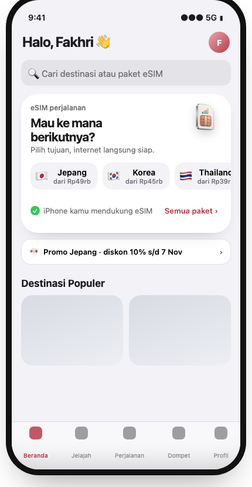
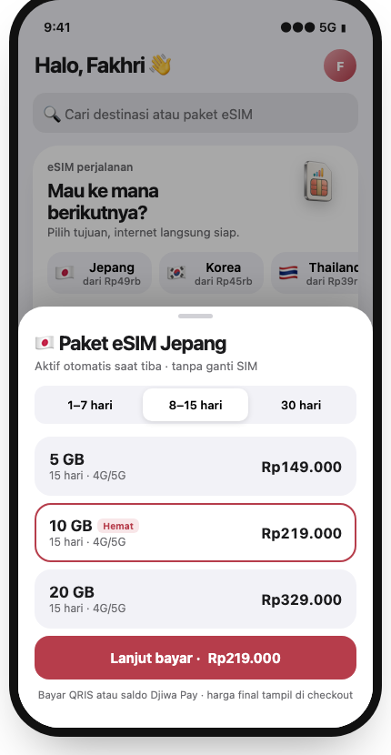
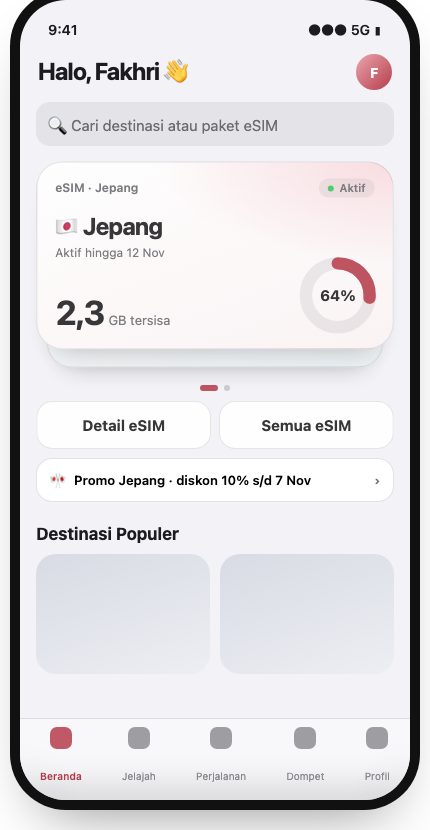
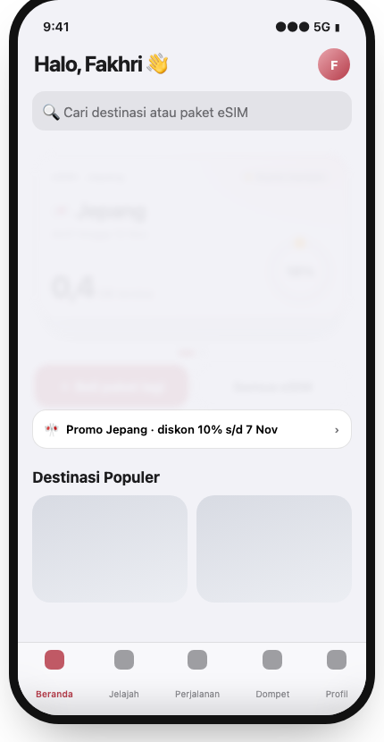
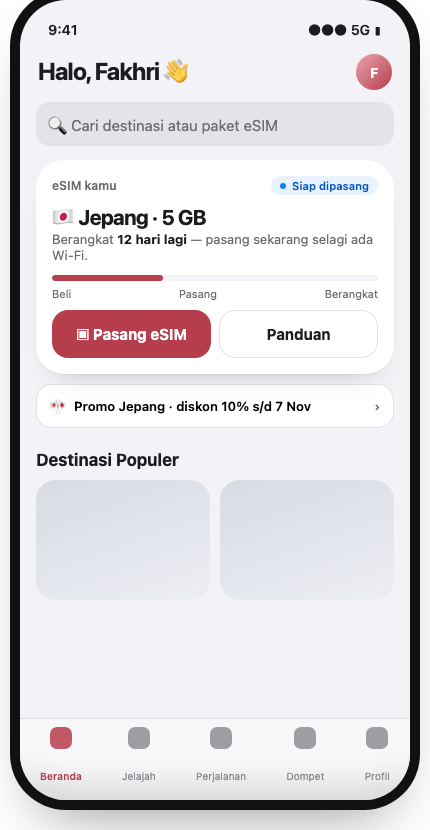
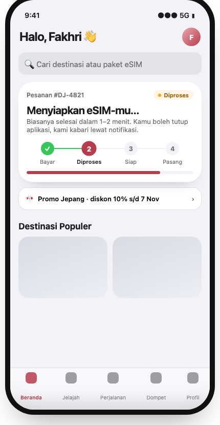
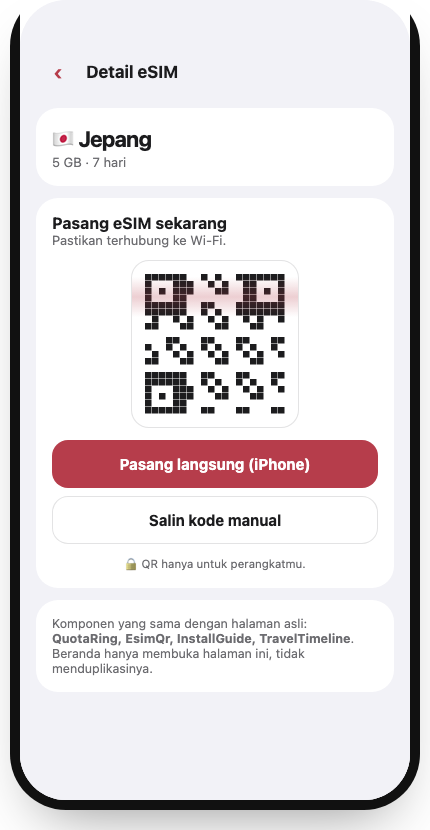
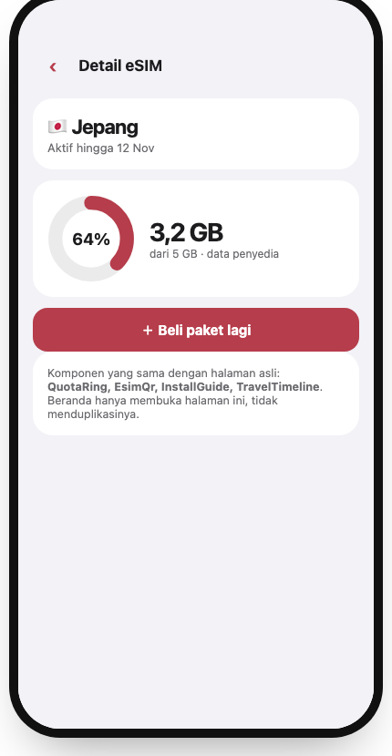

# Rencana perombakan eSIM Beranda — "Wallet Pass" (terang, shared-first)

Status: **diimplementasi lokal (2026-11-01); migrasi 026/027 dan deploy produksi masih menunggu.**
Sepuluh aset 3D sudah dibuat dan dipasang. Deviasi dan temuan schema drift dicatat di §9.
Prototype interaktif (tema terang): [`docs/prototypes/esim-home-redesign.html`](../../prototypes/esim-home-redesign.html)
— hash `#empty #sheet #active #low #ready #pending #install #usage` membuka state tertentu;
panel kiri/bawah di prototype mensimulasikan kontrol Admin yang mengubah Beranda secara langsung.

## 0. Keputusan yang sudah ditetapkan

| Keputusan | Pilihan |
| --- | --- |
| Cakupan | Seluruh Wallet Pass sekaligus (dirilis per fase, tetapi satu desain) |
| Tema | **Terang** — pass putih/pastel, teks gelap, brand red hanya untuk aksi utama |
| Admin | Toggle Beli cepat + urutan destinasi + ambang kuota menipis + **banner promo** |
| Aset 3D | **Set baru** (pass per negara + ikon state); chip berwarna lama dipensiunkan |
| Prinsip | **Satu sistem per kemampuan.** Beranda hanya *menyusun* modul bersama; tidak menyalin alur halaman lain |

## 1. Masalah kartu sekarang

| # | Temuan | Dampak |
| --- | --- | --- |
| 1 | State kosong hanya teks + 1 tombol → dialog search → hasil → checkout (4+ ketukan). | Konversi lambat, kartu 164 px nyaris kosong. |
| 2 | Semua state memakai kartu abu + baris aksi yang sama. | Hierarki lemah, belum terasa seperti app iOS. |
| 3 | Multi-eSIM = titik halaman kecil; tanpa gestur/transisi. | Terasa web. |
| 4 | Satu-satunya gerak: chip melayang **loop** (`repeat: Infinity`). | Melanggar `DESIGN.md` (hindari looping), tidak responsif sentuhan. |
| 5 | Pending: badge + kalimat saja. | Pelanggan tidak tahu progres. |
| 6 | Tidak terhubung ke `departureDate` My Trips. | Kehilangan pemicu "pasang sebelum berangkat". |
| 7 | Tidak ada kontrol Admin. | Melanggar aturan pasangan customer/admin `AGENTS.md`. |
| 8 | `TAB_PATHS` di `src/lib/motion.ts` usang (`/esim/finder`, `/my-esim`) vs nav bawah sekarang. | Arah transisi halaman bisa salah. |

## 2. Audit duplikasi → satu sumber bersama

Hasil pemeriksaan kode. Kolom kanan = satu-satunya tempat logika itu boleh hidup setelah perombakan.

| Kemampuan | Sekarang (duplikat / berpotensi) | Setelah rencana (shared) |
| --- | --- | --- |
| Daftar paket per destinasi | loader `destination.$code.tsx` (`getResellerCatalog` → `toViewPackages`) **dan** `searchHomeEsimCatalog` (dialog Home). Sheet baru akan jadi salinan ketiga. | Satu modul server `esim-destination-packages.server.ts` + satu server fn `getDestinationPackages(code)` (sellability + `toViewPackage`, tanpa cost/markup). Dipakai loader destinasi, sheet Home, dan hasil search. |
| UI pemilih paket | daftar paket di halaman destinasi (UI sendiri) | Satu `EsimPackagePicker` (segmen durasi + baris paket + CTA). Dipakai halaman destinasi **dan** sheet Home. |
| Daftar destinasi | `getListableDestinations` dipakai finder; rel Home akan membuat query baru | Rel Home = `getListableDestinations` + urutan Admin. Tidak ada fungsi destinasi kedua. |
| Pencarian teks | dialog Home (satu-satunya input) | Tetap satu. Ketuk bendera **dan** hasil destinasi di dialog → membuka **sheet yang sama**. Tidak ada input kedua di kartu. |
| Label/nada status | `ORDER_STATUS_LABEL/TONE` (`esim-status.ts`, dipakai 6 file) **dan** `statusBadge()` lokal di kartu | Satu `EsimStatusBadge` yang menurunkan label/nada dari `esim-status.ts`; hapus `statusBadge`/`Badge` lokal kartu. |
| Cincin kuota | `QuotaRing` lokal kartu **dan** `TravelUsageCard` | Satu `QuotaRing` (`components/esim-quota-ring.tsx`), dipakai kartu, pass, `TravelUsageCard`. |
| Ambang menipis | konstanta `LOW_QUOTA_PERCENT = 20` (`travel-journey.ts`) | `usageView` menerima ambang dari satu resolver `resolveLowQuotaPercent(config)`; 20 tetap default. Tidak ada angka kedua. |
| Detail eSIM | halaman `/my-esim/$id` | Mengetuk pass depan = **navigasi ke `/my-esim/$id`** (transisi elemen bersama). **Tidak ada sheet detail** di Beranda. |
| Pemasangan (QR/kode/panduan) | `EsimQr`/`InstallGuide` dipakai `order.$id` **dan** `my-esim.$id` | CTA "Pasang eSIM" → `/my-esim/$id` (bagian pasang yang sudah ada). **Tidak ada sheet QR di Beranda.** Saat implementasi, `order.$id` dan `my-esim.$id` disatukan ke satu `EsimInstallPanel`. |
| Progres pesanan | `TravelTimeline` (`my-esim.$id`) | Stepper kartu diturunkan dari **builder timeline yang sama** (`travel-journey`); tidak ada mesin status baru. |
| Urutan/pilihan eSIM | `sortEsimHomeOrders` / `buildEsimHomeSummary` | Tetap satu-satunya selector; tumpukan pass hanya mengganti presentasi. |
| Beli lagi | `reorderIntent` | Tetap satu. |
| Konfigurasi Admin | tabel `admin_settings` + `AdminSettingKey`/`validateAdminSetting`/`buildSettingAudit` sudah ada (migrasi 004), `admin.settings` baru hanya readiness | Tambah **satu key `homeEsim`** di mekanisme yang sama (versi + audit sudah tersedia). **Tanpa tabel baru.** Satu fn server `getHomeEsimConfig()` dibaca kartu, sheet, ambang kuota, banner. |
| Preset gerak | `lib/motion.ts` + `motion-primitives.tsx` | Hanya preset ini; tidak ada kurva/spring baru. Sheet memakai primitif `ui/sheet.tsx`/`drawer.tsx` yang ada (diverifikasi mendukung seret-tutup; jika tidak, diperluas di sana, bukan membuat sheet baru). |
| Seni destinasi | bendera emoji + chip tunggal | Satu peta `destination-art.ts` (kode negara → aset 3D). Dipakai pass, rel, finder, `my-esim.index`, header destinasi. |

Aturan tinjauan: PR yang menambah komponen/fn baru harus menyebut modul bersama mana yang diganti
atau dipakai ulang; reviewer menolak jika alur yang sama tertulis dua kali.

## 3. Konsep & gambaran (tema terang)

Metafora Apple Wallet + Live Activity: eSIM = pass yang bisa disentuh.

- **Kosong → Beli cepat:** "Mau ke mana berikutnya?", rel destinasi (urutan Admin, harga "dari Rp…"),
  ringkasan kompatibilitas perangkat. Ketuk → sheet paket → `/checkout/$packageCode` (2 ketukan).
- **Aktif:** pass terang bertinta negara, kuota besar (counter), cincin kuota, pass lain mengintip.
  Swipe/ketuk ganti pass; ketuk pass depan → `/my-esim/$id`.
- **Menipis:** cincin oranye (ambang Admin), "Beli paket lagi" berdenyut 2× lalu diam.
- **Siap dipasang:** progres Beli → Pasang → Berangkat + "Berangkat N hari lagi"; "Pasang eSIM" → `/my-esim/$id`.
- **Diproses:** stepper Bayar → Diproses → Siap → Pasang, berpindah otomatis lewat refresh yang ada.
- **Banner promo (Admin):** satu baris di bawah kartu; membuka sheet paket yang sama (promo hanya di
  Beranda — tidak masuk notifikasi operasional, sesuai guard di `growth-loops.ts`).

| Kosong | Sheet paket | Aktif |
| --- | --- | --- |
|  |  |  |

| Menipis | Siap dipasang | Diproses |
| --- | --- | --- |
|  |  |  |

| Pasang (= `/my-esim/$id`) | Detail kuota (= `/my-esim/$id`) |
| --- | --- |
|  |  |

## 4. Spesifikasi gerak (`motion/react` v12, preset `lib/motion.ts`)

| Elemen | Implementasi | Reduced motion |
| --- | --- | --- |
| Pergantian state | `AnimatePresence mode="popLayout"`, opacity+y+blur singkat | fade 120 ms |
| Bendera → sheet | `layoutId` bersama, sheet `springSheet` | fade |
| Seret-tutup sheet | `drag="y"`, tutup bila offset >110 px atau velocity >500 | tombol tutup tetap |
| Tumpukan pass | `animate {y, scale}`; `drag="x"` ambang 40 px; `touch-action: pan-y`; `pressable` | posisi statis |
| Pass → detail | `layoutId` pass → header `/my-esim/$id` (fallback fade jika rute lain gagal memetakan) | fade |
| Cincin & angka | `pathLength` 0→nilai; `MotionCounter` yang ada | langsung |
| Chip/pass 3D | tilt mengikuti pointer (`useTransform`), kembali `springSnappy`; **tanpa loop** | tanpa tilt |
| CTA menipis | 2 pulsa lalu berhenti | tanpa |
| Stepper | skala titik aktif, garis terisi `scaleX` | langsung |

Hanya `opacity`/`transform` (+ blur singkat). Kontrol tetap `<button>/<a>` ≥44 px; swipe selalu
punya alternatif ketuk + keyboard (Arrow/Home/End seperti pager sekarang).

## 5. Admin (pasangan customer)

Lokasi: `admin.settings` → panel "eSIM Beranda" (peran admin yang ada; tulis lewat
`validateAdminSetting` + `buildSettingAudit` → `admin.audit-log`).

Bentuk nilai `admin_settings.homeEsim` (versi di tabel yang sudah ada):

```
{ quickBuyEnabled: boolean,
  destinationOrder: string[],        // kode negara, divalidasi terhadap getListableDestinations
  lowQuotaPercent: number,           // 5–40, default 20
  promo: { enabled, text (≤80), destinationCode?, startsAt?, endsAt? } }
```

| Aspek | Customer | Admin |
| --- | --- | --- |
| Entry | kartu Beranda, sheet paket, banner promo, `/my-esim/$id` | panel "eSIM Beranda" + pratinjau kartu |
| Sumber kebenaran | `getHomeEsimConfig()` (satu fn) | sama |
| Efek terlihat | urutan rel, ambang badge "menipis", banner tampil/hilang sesuai jadwal | simpan → Beranda berubah di muat berikutnya |
| Kegagalan | konfigurasi gagal dimuat → default aman (Beli cepat aktif, ambang 20, tanpa promo) | gagal simpan menampilkan galat, tidak diam-diam sukses |
| Pemantauan | `trackAnalytics`: `home_esim_chip_tap`, `sheet_open`, `promo_tap`, `checkout_start` | `admin.analytics` corong; `admin.provisioning` untuk pesanan macet di "Diproses" |
| Bukti konsistensi (tes) | ubah config → rel/ambang/banner berubah di kartu | loader admin menolak non-admin; tulis menghasilkan baris audit |

Tidak berubah: batas Djiwa Pay, 5 tab navigasi, harga/markup tidak dikirim ke browser (`toViewPackage`),
QR/kode hanya di konteks pesanan milik user (tidak ada di ringkasan Beranda).

## 6. Set aset 3D baru

Mengikuti kontrak aset `DESIGN.md`: satu keluarga material, cahaya key lembut, bayangan kontak halus,
latar transparan, WebP/AVIF, <100 KB per ikon kecil, dimensi intrinsik, alt kosong (dekoratif), fallback
bendera emoji, manifest berisi sumber/lisensi/tanggal tinjau.

| Aset | Nama |
| --- | --- |
| Pass per negara (Jepang, Korea, Thailand, Singapura, Arab Saudi) | `esim-pass-jp-v1.webp` … |
| Regional Asia, Global | `esim-pass-asia-v1.webp`, `esim-pass-global-v1.webp` |
| Ikon state: siap dipasang, diproses, kuota menipis | `esim-state-ready-v1.webp` … |

Palet terang (ivory + tinta negara pastel + aksen merah Djiwa), konsisten dengan prototype.
Dibuat dengan satu prompt dasar + variasi per negara agar serasi; dipetakan lewat `destination-art.ts`.
`public/assets/esim/esim-chip-color-v1.png` dan `travel-pass-v1.png` dipensiunkan setelah tidak dirujuk
(cek referensi sebelum hapus).

## 7. Fase (tiap fase bisa dirilis sendiri; Wallet Pass utuh = akhir fase 5)

| Fase | Isi | Shared yang dihasilkan | Verifikasi |
| --- | --- | --- | --- |
| 0 | Fondasi tanpa perubahan tampilan: `getDestinationPackages` + `EsimPackagePicker` (halaman destinasi memakainya), `EsimStatusBadge`, `QuotaRing`, `resolveLowQuotaPercent`, perbaiki `TAB_PATHS`, hapus loop float | semua modul §2 | tes yang ada tetap hijau; snapshot destinasi tak berubah |
| 1 | Admin: key `homeEsim`, validasi, audit, `getHomeEsimConfig`, panel admin + pratinjau | config tunggal | tes validasi/otorisasi/audit; default aman saat gagal |
| 2 | Beli cepat: rel + sheet (memakai picker & fn fase 0), banner promo, analytics | — | e2e 375 px ≤2 ketukan; ubah admin → rel berubah |
| 3 | Tumpukan pass + navigasi ke `/my-esim/$id` + cincin/counter | — | tes keyboard pager, reduced-motion, gestur vs scroll |
| 4 | Stepper dari timeline bersama + pra-keberangkatan + `EsimInstallPanel` bersama | `EsimInstallPanel` | tes kepemilikan; QR tidak di ringkasan |
| 5 | Set aset 3D + `destination-art.ts` di semua permukaan | peta aset | ukuran bundle, loading lambat, alt/fallback |

## 8. Risiko & hal yang diverifikasi saat implementasi

- Sheet: pastikan `ui/drawer.tsx` mendukung seret-tutup dan fokus; jika tidak, perluas primitif itu.
- Gestur horizontal tumpukan vs scroll vertikal Beranda (`touch-action: pan-y`).
- Transisi `layoutId` lintas rute TanStack Router: jika tidak stabil, pakai fade; jangan dipaksakan.
- Pasang langsung iOS/Android lewat universal link (iOS 17.4+/Android) **belum diverifikasi** terhadap
  format `activationCode` eSIM Access; fallback QR + salin kode tetap.
- `order.$id` dan `my-esim.$id` mungkin memakai UI pasang yang sedikit berbeda; audit sebelum menyatukan.
- Promo: validasi jadwal di server (bukan jam klien); teks dibatasi, tanpa HTML.

## 9. Deviasi & status implementasi (2026-11-01)

- Rel destinasi memakai feed populer Beranda (`getHomeDestinationFeed`), bukan `getListableDestinations`
  (tidak ada fetch kedua). Admin hanya mengurutkan destinasi yang ada di feed itu. Chip tidak memuat
  "dari Rp…" (butuh agregasi harga per destinasi).
- Baris kompatibilitas perangkat tidak ditambahkan; sudah ada di checkout (`DeviceCompatibility`).
- UI pasang sudah satu sumber: `EsimInstallPanel` (QR + pasang langsung + catatan privasi) dipakai
  `order.$id` dan `my-esim.$id`. Pasang langsung memakai link universal Apple/Google
  (`esimsetup.apple.com` / `esimsetup.android.com`, `carddata=LPA:1$…`); sumber vendor, termasuk
  eSIM Access, tapi belum diuji di perangkat.
- Pra-keberangkatan: kartu membaca tanggal berangkat dari `readTripPlan` (localStorage per order),
  jadi hanya muncul bila pelanggan sudah mengisinya di detail eSIM.
- Aset 3D: set 10 file dibuat dengan OpenAI imagegen lewat Codex CLI (2026-11-01), dioptimalkan ke
  WebP 192 px (6–11 KB), dipetakan di `destination-art.ts`; chip lama dan `travel-pass-v1.png`
  dipensiunkan. Detail di `public/assets/esim/ASSET-MANIFEST.md`.
- Analytics: event Beranda dicatat ke sink first-party anonim (`home_esim_events`, migrasi 026,
  `/api/home-esim-events`) dan corongnya tampil di Admin → Analytics. Migrasi 026 membuat tabel event.
- Preflight produksi menemukan schema drift: `004_admin_operations.sql` tercatat applied, tetapi
  `admin_users`, `admin_audit_logs`, dan `admin_settings` tidak ada di database. Migrasi forward-only
  027 memulihkan tabel server-side yang dibutuhkan pengaturan eSIM dan audit.
- Sheet detail dan sheet QR di Beranda tidak dibuat (sesuai prinsip tanpa duplikasi): pass membuka
  `/my-esim/$id`.
